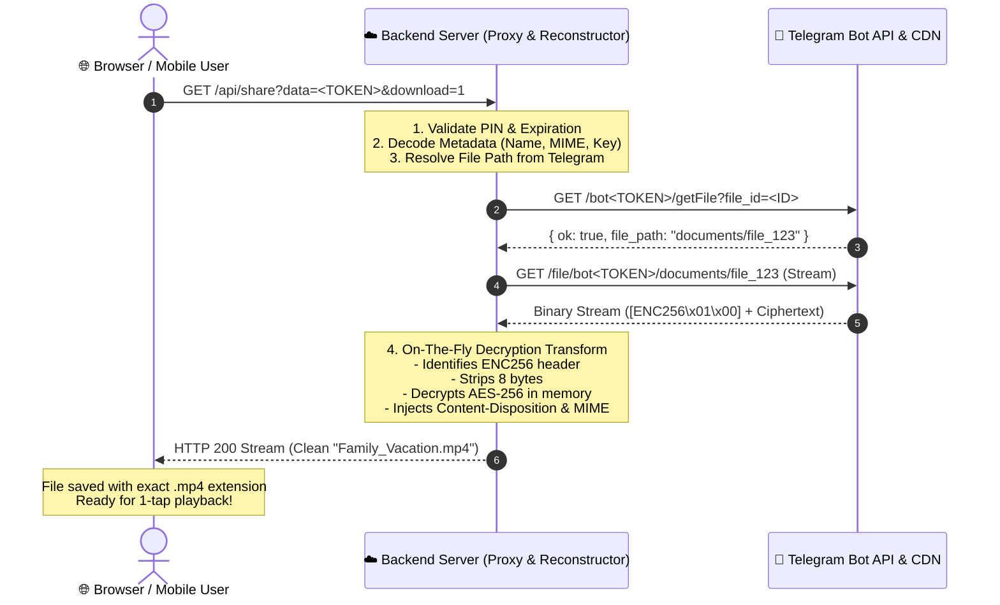

# 📦 Telegram Backup Cloud — File Sharing & Download Architecture Specification

---

## 📑 Table of Contents
1. [Executive Summary](#1-executive-summary)
2. [Deep Root Cause Analysis: The Download & Format Bugs](#2-deep-root-cause-analysis-the-download--format-bugs)
   - [Bug 1: Browser Cross-Origin Security Stripping File Extensions](#bug-1-browser-cross-origin-security-stripping-file-extensions)
   - [Bug 2: Unconditional Decryption Corrupting Unencrypted Media Headers](#bug-2-unconditional-decryption-corrupting-unencrypted-media-headers)
   - [Bug 3: Encrypted Share Links Delivering Raw Ciphertext to Web Users](#bug-3-encrypted-share-links-delivering-raw-ciphertext-to-web-users)
   - [Bug 4: Vercel Serverless URL Path Stripping](#bug-4-vercel-serverless-url-path-stripping)
3. [The Complete Solution: End-to-End Architecture](#3-the-complete-solution-end-to-end-architecture)
   - [Phase 1: Safe Encryption with 8-Byte Magic Header](#phase-1-safe-encryption-with-8-byte-magic-header)
   - [Phase 2: Share Token Serialization & Security Metadata](#phase-2-share-token-serialization--security-metadata)
   - [Phase 3: Zero-Disk On-The-Fly Decryption & Reconstruction Engine](#phase-3-zero-disk-on-the-fly-decryption--reconstruction-engine)
   - [Phase 4: RFC-5987 Content-Disposition & MIME Header Injection](#phase-4-rfc-5987-content-disposition--mime-header-injection)
   - [Phase 5: In-Browser Streaming vs Attachment Download](#phase-5-in-browser-streaming-vs-attachment-download)
4. [Sequence Diagram: End-to-End Data Flow](#4-sequence-diagram-end-to-end-data-flow)
5. [Key File Directory & Code References](#5-key-file-directory--code-references)
6. [Summary Checklist for Senior Developers](#6-summary-checklist-for-senior-developers)

---

## 1. Executive Summary

In early builds, users reported that files downloaded from cloud share links or restored to devices were encountering **file format issues**, **missing extensions (`.mp4`, `.pdf`, `.zip`, `.apk`)**, or were **unopenable / corrupted**.

This document outlines the **exact root causes**, **the engineering flaws that caused them**, and the **production-grade architectural solution implemented in v2.1.72 (Build 75)**.

---

## 2. Deep Root Cause Analysis: The Download & Format Bugs

### Bug 1: Browser Cross-Origin Security Stripping File Extensions
* **Symptom**: When a recipient clicked "Download" on a shared link, the file downloaded as `file_123` or `download.bin` without an extension.
* **Flawed Implementation**:
  The backend previously returned an HTTP `302 Redirect` to Telegram's raw CDN endpoint:
  ```http
  HTTP/1.1 302 Found
  Location: https://api.telegram.org/file/bot<token>/documents/file_123
  ```
  The frontend HTML tried to force the name with:
  ```html
  <a href="https://api.telegram.org/file/bot.../file_123" download="My_Video.mp4">Download</a>
  ```
* **Why It Failed (CORS & Browser Spec)**:
  According to modern W3C/HTML5 security standards, all modern web browsers (Google Chrome, Apple Safari, Mozilla Firefox, Microsoft Edge, iOS Safari, Android Chrome) **strictly ignore the `download="..."` attribute on cross-origin URLs**.
  When the browser followed the 302 redirect to `api.telegram.org`, Telegram responded with its internal object name (`file_123`) without `Content-Disposition`. The browser saved it with no extension, making it unopenable by the OS.

---

### Bug 2: Unconditional Decryption Corrupting Unencrypted Media Headers
* **Symptom**: Unencrypted photos, videos, audio files, and PDFs restored inside the Android app became corrupted and failed to open.
* **Flawed Implementation**:
  In `CloudRestoreWizardDialog.kt` and `TelegramMediaResolver.kt`:
  ```kotlin
  // Old Corrupting Logic:
  if (prefs.encryptionKey.isNotEmpty()) {
      FileEncryptor.decryptFileInPlace(targetFile, prefs.encryptionKey)
  }
  ```
* **Why It Failed**:
  If the user backed up a file **without encryption enabled**, but later configured an encryption key in settings, the app ran `CipherInputStream(AES-CBC)` over **valid plain media bytes**.
  This scrambled the first 16 bytes and corrupted magic headers:
  * JPEG: `FF D8 FF`
  * PNG: `89 50 4E 47`
  * MP4: `00 00 00 ... ftypisom`
  * PDF: `25 50 44 46 (%PDF)`
  * ZIP/APK: `50 4B 03 04 (PK..)`
  The damaged header made the file unrecognizable to media players and PDF viewers.

---

### Bug 3: Encrypted Share Links Delivering Raw Ciphertext to Web Users
* **Symptom**: When an encrypted file was shared, web recipients downloaded raw scrambled AES ciphertext that no standard player could open.
* **Why It Failed**:
  Telegram servers only store zero-knowledge ciphertext. A web browser does not have the user's Android keystore. Without server-side on-the-fly decryption, the recipient received useless encrypted bytes.

---

### Bug 4: Vercel Serverless URL Path Stripping
* **Symptom**: Share endpoints returned `404 Not Found` intermittently.
* **Why It Failed**:
  Vercel Serverless Functions strip the `/api` prefix or rewrite paths in `vercel.json`, converting `GET /api/share?data=...` into `GET /?data=...`. If Express was listening strictly on `app.get('/api/share')`, the route failed to match.

---

## 3. The Complete Solution: End-to-End Architecture

```
                                  ┌─────────────────────────────────────────┐
                                  │           Android Client (App)          │
                                  └────────────────────┬────────────────────┘
                                                       │
                                  Upload Encrypted (with Magic Header ENC256)
                                                       │
                                                       ▼
                                  ┌─────────────────────────────────────────┐
                                  │      Telegram Cloud Edge (Storage)      │
                                  │   Stores: [ENC256\x01\x00][AES-Cipher]  │
                                  └────────────────────┬────────────────────┘
                                                       │
                                     Direct Stream Request (via Bot API)
                                                       │
                                                       ▼
┌───────────────────────────┐     ┌─────────────────────────────────────────┐
│     Recipient Browser     │◄────┤     Vercel / Node.js Backend Server     │
│  Receives Clean Original  │     │ 1. Intercepts Stream                    │
│   "Family_Video.mp4"      │     │ 2. Strips Magic Header                  │
│    (1-Tap Play/Open)      │     │ 3. On-The-Fly AES-256 Decrypt Stream    │
└───────────────────────────┘     │ 4. Injects RFC-5987 Headers             │
                                  └─────────────────────────────────────────┘
```

---

### Phase 1: Safe Encryption with 8-Byte Magic Header
In `FileEncryptor.kt`:
* Every encrypted file is prepended with an 8-byte magic header:
  `MAGIC_HEADER = [0x45, 0x4E, 0x43, 0x32, 0x35, 0x36, 0x01, 0x00]` → ASCII: `"ENC256"` + `\x01\x00`
* **Strict Verification**:
  ```kotlin
  fun isEncryptedFile(file: File): Boolean {
      if (!file.exists() || file.length() < 8) return false
      FileInputStream(file).use { fis ->
          val header = ByteArray(8)
          return fis.read(header) == 8 && header.contentEquals(MAGIC_HEADER)
      }
  }
  ```
* `decryptFileInPlace()` now checks `isEncryptedFile(file)`. Plain files are **never** touched by the cipher.

---

### Phase 2: Share Token Serialization & Security Metadata
In `ShareLinkManager.kt`:
When generating a share link, metadata is encoded into a URL-safe Base64 token:
```json
{
  "fileId": "BAACAgUAAxkBAAI...",
  "fileName": "Family_Vacation_4K.mp4",
  "fileSize": 52428800,
  "botToken": "7182938491:AAH...",
  "directUrl": "https://api.telegram.org/file/bot...",
  "encryptionKey": "UserMasterKey123!",
  "expiresAt": 1771500000000,
  "pin": "1234"
}
```

---

### Phase 3: Zero-Disk On-The-Fly Decryption & Reconstruction Engine
In `server/index.js`:
Instead of downloading files to the server's disk (which would fail on Vercel's 512 MB disk limit and cause high latency), the server uses **Node.js Crypto Transform Streams**:

```javascript
const { Transform, Readable } = require('stream');
const crypto = require('crypto');

// 1. Fetch live stream from Telegram
const streamRes = await fetch(directTelegramStreamUrl);
const nodeStream = Readable.fromWeb(streamRes.body);

// 2. Real-time In-Memory Decryption Transform
let headerProcessed = false;
let tempBuf = Buffer.alloc(0);
let decipherInstance = null;

const decryptTransform = new Transform({
  transform(chunk, encoding, callback) {
    if (!headerProcessed) {
      tempBuf = Buffer.concat([tempBuf, chunk]);
      if (tempBuf.length >= 8) {
        const magic = Buffer.from([0x45, 0x4E, 0x43, 0x32, 0x35, 0x36, 0x01, 0x00]);
        if (tempBuf.subarray(0, 8).equals(magic)) {
          // Encrypted file detected -> initialize AES decipher
          const key = crypto.createHash('sha256').update(secretKey, 'utf8').digest();
          const iv = crypto.createHash('md5').update(secretKey, 'utf8').digest();
          decipherInstance = crypto.createDecipheriv('aes-256-cbc', key, iv);
          const decChunk = decipherInstance.update(tempBuf.subarray(8));
          if (decChunk.length > 0) this.push(decChunk);
        } else {
          // Plain unencrypted file -> pass through untouched
          this.push(tempBuf);
        }
        headerProcessed = true;
        tempBuf = null;
      }
      return callback();
    }
    if (decipherInstance) {
      const dec = decipherInstance.update(chunk);
      if (dec.length > 0) this.push(dec);
    } else {
      this.push(chunk);
    }
    callback();
  },
  flush(callback) {
    if (decipherInstance) {
      const finalChunk = decipherInstance.final();
      if (finalChunk.length > 0) this.push(finalChunk);
    }
    callback();
  }
});

// 3. Pipe directly into client HTTP response
return nodeStream.pipe(decryptTransform).pipe(res);
```

---

### Phase 4: RFC-5987 Content-Disposition & MIME Header Injection
To guarantee that Windows, macOS, Android, and iOS save the file with the exact original name and extension, the server injects standardized RFC-5987 headers:

```http
HTTP/1.1 200 OK
Content-Type: video/mp4
Content-Disposition: attachment; filename="Family_Vacation.mp4"; filename*=UTF-8''Family_Vacation.mp4
Accept-Ranges: bytes
Cache-Control: public, max-age=86400
```
* `filename="..."`: Backward-compatible ASCII fallback.
* `filename*=UTF-8''...`: RFC-5987 standard supporting Unicode, Hindi, Arabic, Japanese, and spaces.
* `Accept-Ranges: bytes`: Allows media players to scrub and seek videos/audio.

---

### Phase 5: In-Browser Streaming vs Attachment Download
The server supports two streaming modes:
1. **Download Attachment Mode** (`/api/share?data=...&download=1`):
   - Sets `Content-Disposition: attachment`.
   - Browser immediately triggers native file download with full extension.
2. **In-Browser Streaming Mode** (`/api/share?data=...&stream=1`):
   - Sets `Content-Disposition: inline`.
   - Used by `<video>`, `<audio>`, and `` tags on the web portal to play encrypted files directly inside Safari, Chrome, and Edge without saving.

---

## 4. Sequence Diagram: End-to-End Data Flow



---

## 5. Key File Directory & Code References

| File Path | Description | Key Mechanism |
| :--- | :--- | :--- |
| [`server/index.js`](file:///d:/Workspace/proj/game/server/index.js) | Backend API & Web Share Portal | Stream proxy, `Transform` decryption, RFC-5987 headers |
| [`FileEncryptor.kt`](file:///d:/Workspace/proj/game/TelegramBackup/app/src/main/java/com/example/telegrambackup/utils/FileEncryptor.kt) | Android AES-256 Encryptor | `MAGIC_HEADER` injection & `isEncryptedFile()` guard |
| [`ShareLinkManager.kt`](file:///d:/Workspace/proj/game/TelegramBackup/app/src/main/java/com/example/telegrambackup/utils/ShareLinkManager.kt) | Share Link Token Generator | Base64 URL-safe token serialization with key metadata |
| [`TelegramMediaResolver.kt`](file:///d:/Workspace/proj/game/TelegramBackup/app/src/main/java/com/example/telegrambackup/utils/TelegramMediaResolver.kt) | Cloud Media Resolver & Cache | Multi-bot URL failover & guarded cache decryption |
| [`CloudRestoreWizardDialog.kt`](file:///d:/Workspace/proj/game/TelegramBackup/app/src/main/java/com/example/telegrambackup/ui/explorer/CloudRestoreWizardDialog.kt) | Batch Cloud Restorer | Safe in-place restore with encryption check |

---

## 6. Summary Checklist for Senior Developers

1. **Never 302 Redirect to Telegram Raw CDN for Downloads**: Always proxy the stream through Node.js to preserve `Content-Disposition` and `Content-Type`.
2. **Always Use RFC-5987 Header Format**: Use `filename="safe.ext"; filename*=UTF-8''exact%20name.ext` for 100% universal OS compatibility.
3. **Always Check Magic Bytes Before Decrypting**: Never run AES decryption on arbitrary files; check for `ENC256\x01\x00`.
4. **Use In-Memory Streams for Large Files**: Avoid writing temp files to disk on serverless platforms (Vercel/AWS Lambda) to prevent disk exhaustion and optimize latency.
